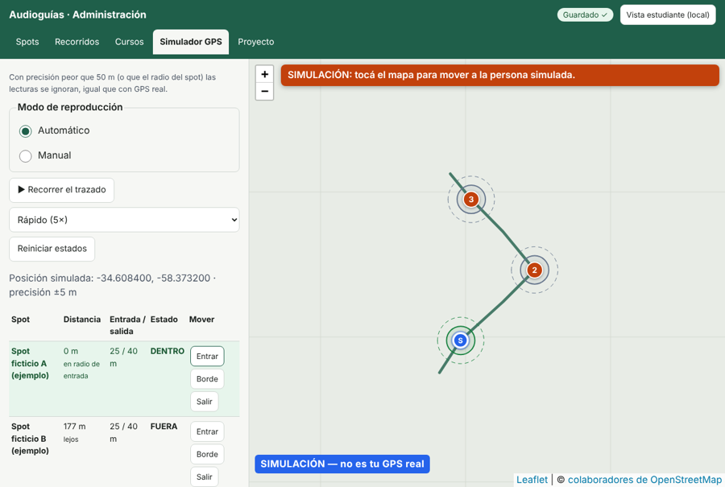
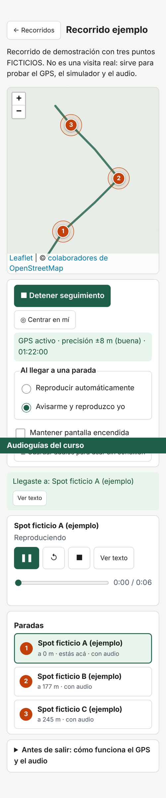

# Audioguía geolocalizada (PWA gratuita)

Aplicación web progresiva para crear **audioguías al aire libre**: el/la docente arma spots (paradas con texto,
audio e imagen), recorridos trazados a mano y cursos con enlace/QR; los estudiantes abren el enlace en el celular,
siguen el recorrido con el GPS y escuchan cada parada al llegar.

- 100 % estático: HTML + CSS + JavaScript, sin servidor, sin cuentas, sin anuncios, sin APIs pagas ni de IA.
- Mapa: Leaflet + OpenStreetMap (con atribución visible).
- Editor *local-first*: todo se guarda en el navegador del docente (IndexedDB) y se **exporta** para publicar.
- Alojamiento gratuito sugerido: **GitHub Pages** (HTTPS incluido, necesario para GPS y micrófono).

> Los enlaces por curso sirven para **distribuir**, no son seguridad: cualquiera con el enlace entra, y
> `data/project.json` es público. No cargues información privada.

---

## 1. Requisitos

- Para **usar**: un navegador actual (Chrome/Edge/Firefox/Safari; Android o iPhone). Nada que instalar.
- Para **probar en tu computadora**: Python 3 (ya viene en macOS/Linux; en Windows instalalo de python.org)
  o cualquier servidor estático. *No* funciona abriendo `index.html` con doble clic (`file://`).
- Para **publicar**: una cuenta gratuita de GitHub.
- Opcional para desarrollo: Node 18+ (pruebas unitarias) y Playwright (prueba de punta a punta).

## 2. Correr localmente

```bash
cd audioguia
```

```bash
python3 -m http.server 8080
```

Abrí:
- Administración: <http://localhost:8080/admin.html>
- Estudiante (curso de ejemplo): <http://localhost:8080/?curso=curso-ejemplo>
- Estudiante con tus datos sin publicar: <http://localhost:8080/?fuente=local>

`localhost` cuenta como contexto seguro, así que GPS y micrófono funcionan en la computadora. Para probar con
el **teléfono** necesitás HTTPS: lo más simple es publicar en GitHub Pages (sección 4).

## 3. Estructura de carpetas

```
audioguia/
├── index.html            Vista del estudiante (entra con ?curso=<id>)
├── admin.html            Panel de administración (spots, recorridos, cursos, simulador, proyecto)
├── manifest.webmanifest  Manifiesto PWA (instalable)
├── sw.js                 Service worker: cachea la interfaz y audios elegidos (no los mapas)
├── files-list.js         Lista de archivos de la app (precache y exportación del sitio)
├── .nojekyll             Evita que GitHub Pages procese el sitio con Jekyll
├── css/app.css           Estilos (responsive, modo oscuro, foco visible)
├── js/
│   ├── model.js          Modelo SPOT / RECORRIDO / CURSO, validación y normalización
│   ├── geo.js            Distancias + motor de proximidad con histéresis
│   ├── player.js         Reproductor con cola de activaciones
│   ├── player-ui.js      Controles accesibles del reproductor
│   ├── db.js             IndexedDB (proyecto + audios/imágenes)
│   ├── media-tools.js    Grabación (MediaRecorder), validación, conversión a WAV, imágenes
│   ├── zip.js            ZIP sin dependencias (exportar/importar)
│   ├── exportar.js       Exportar sitio/datos, importar, sembrar desde data/
│   ├── datos.js          Carga del proyecto publicado o local
│   ├── mapa.js           Ayudas de Leaflet
│   ├── estudiante.js     Lógica de la vista del estudiante
│   ├── admin.js          Lógica del panel
│   └── admin-sim.js      Simulador de GPS
├── data/
│   ├── project.json      Contenido publicado (lo que ven los estudiantes)
│   └── media/            Audios e imágenes publicados (<id>.<ext>)
├── vendor/               Leaflet 1.9.4 y qrcode-generator 1.4.4 (copias locales, con licencias)
├── icons/                Íconos de la PWA
├── docs/                 GUIA-DOCENTE.md, PRUEBAS.md, LIMITACIONES.md
└── tests/                unit.test.mjs (Node) y e2e.mjs (Playwright)
```

Todas las rutas son **relativas**, así que funciona en un subdirectorio como
`https://usuario.github.io/mi-audioguia/`.

## 4. Publicar en GitHub Pages (gratis)

**Primera vez**
1. En el panel → pestaña **Proyecto** → **“Sitio completo listo para publicar (ZIP)”**. Descomprimilo.
2. En GitHub: **New repository** (por ejemplo `audioguia`), público.
3. **Add file → Upload files**: arrastrá *todo el contenido* de la carpeta descomprimida (incluida `data/`,
   y `.nojekyll`; si tu sistema oculta archivos que empiezan con punto, no es grave). **Commit changes**.
4. **Settings → Pages → Build and deployment → Source: Deploy from a branch**, rama `main`, carpeta `/ (root)` → Save.
5. Esperá 1–2 minutos. La dirección será `https://<tu-usuario>.github.io/<repositorio>/`.
6. Volvé al panel → **Proyecto → URL pública**: pegá esa dirección (así los enlaces y QR de los cursos apuntan ahí).
7. Exportá de nuevo **“Sólo datos”** y subí la carpeta `data/` actualizada (ver abajo), para que el sitio publicado
   también tenga esa URL.

**Actualizar contenido**
1. Panel → Proyecto → **“Sólo datos / respaldo (ZIP)”**.
2. En el repositorio, reemplazá la carpeta `data/` por la del ZIP (Upload files sobrescribe archivos con el mismo
   nombre; los audios viejos que ya no uses podés borrarlos desde GitHub).
3. Los estudiantes ven los cambios al recargar (`data/project.json` se pide siempre a la red primero).

**Importante:** GitHub Pages sólo sirve archivos; la página no puede escribir en el repositorio. Por eso el flujo
es *exportar → subir*. No pongas tokens de GitHub en el código ni en el navegador. (Una alternativa más cómoda
para quien usa Git es `GitHub Desktop`: copiar los archivos exportados a la carpeta del repo y “Push”.)

Límites de GitHub Pages: sitio de hasta ~1 GB, archivos de hasta 100 MB, ~100 GB de transferencia mensual
(sujeto a las políticas de GitHub). Para audios, preferí MP3 mono 64–96 kbps (≈0,5–0,7 MB por minuto).

## 5. Uso (resumen; detalle en `docs/GUIA-DOCENTE.md`)

- **Crear spots**: pestaña Spots → “+ Nuevo spot (tocá el mapa)”. Arrastrá el marcador para moverlo y la manija
  blanca (o el deslizador) para el radio de entrada. Radio de salida > entrada (histéresis).
- **Audio**: “Subir archivo de audio” (MP3/M4A/WAV/OGG/WebM, máx. 25 MB) o “Grabar con el micrófono”
  (permiso → grabar → detener → escuchar → guardar o descartar).
- **Recorridos**: pestaña Recorridos → nuevo → “Dibujar” y tocá el mapa; arrastrá vértices, tocá un vértice para
  eliminarlo o un “+” para insertar. Agregá spots de la biblioteca y ordenalos con ↑ ↓. Estado “Publicado”.
- **Cursos**: asigná recorridos; copiá el enlace o descargá el QR.
- **Simulador GPS**: probá entrada/salida/reingreso/cola sin salir del aula.
- **Respaldos**: exportá “Sólo datos” seguido; el almacenamiento del navegador puede borrarse.

## 6. Conversión de audio (gratis)

- En el panel: botón **“Convertir a WAV”** (funciona en cualquier navegador del estudiante; ocupa más espacio).
- **Audacity** (gratis): Archivo → Exportar → MP3.
- **ffmpeg**:

```bash
ffmpeg -i grabacion.webm -ac 1 -b:a 80k grabacion.mp3
```

## 7. Pruebas

```bash
node --test tests/unit.test.mjs
```

```bash
python3 -m http.server 8080
```

```bash
node tests/e2e.mjs
```

(La prueba e2e requiere Playwright con Chromium; usa GPS y micrófono simulados por el navegador de prueba.)
Ver `docs/PRUEBAS.md` para las pruebas manuales con GPS real y simulado.

## 8. Qué está verificado y qué no

Ver **`docs/LIMITACIONES.md`** (lista honesta de funciones verificadas, no verificadas y restricciones del
GPS/audio en navegadores móviles).

## 9. Licencias y políticas

- Código: MIT (`LICENSE`). Leaflet: BSD-2. qrcode-generator: MIT.
- Mapa: datos © colaboradores de OpenStreetMap (ODbL). Los mosaicos de `tile.openstreetmap.org` se usan bajo
  la [política de uso de tiles de OSMF](https://operations.osmfoundation.org/policies/tiles/): uso moderado,
  atribución visible, sin descargas masivas ni “prefetch”. Por eso la app **no** guarda mapas offline.
  Si tu uso crece, cambiá el proveedor en Proyecto → Avanzado.
- Audios e imágenes que subas: asegurate de tener derechos para publicarlos.

## 10. Capturas (entorno de prueba, mapa base reemplazado por fondo liso)

| Simulador (admin) | Estudiante con GPS |
|---|---|
|  |  |
